# Legacy of Nations

A cross-platform turn-based strategy (TBS) game built in Unity and C#, focusing on territorial conquest, state economy management, technology progression, and multi-tier diplomacy.

Developed as an engineering diploma thesis (*Projekt i implementacja wieloplatformowej strategicznej gry turowej*) at the Lublin University of Technology (*Politechnika Lubelska*), the project bridges the gap between casual strategy games (such as *Risk*) and complex grand strategy titles (such as *Europa Universalis IV* or *Civilization VI*). It introduces players to deep strategic mechanics through an intuitive, accessible, and minimalist interface.

---

## Screenshots

| Core Gameplay: Hex World Map, Province Inspection & Economy Bar |
|:---:|
| 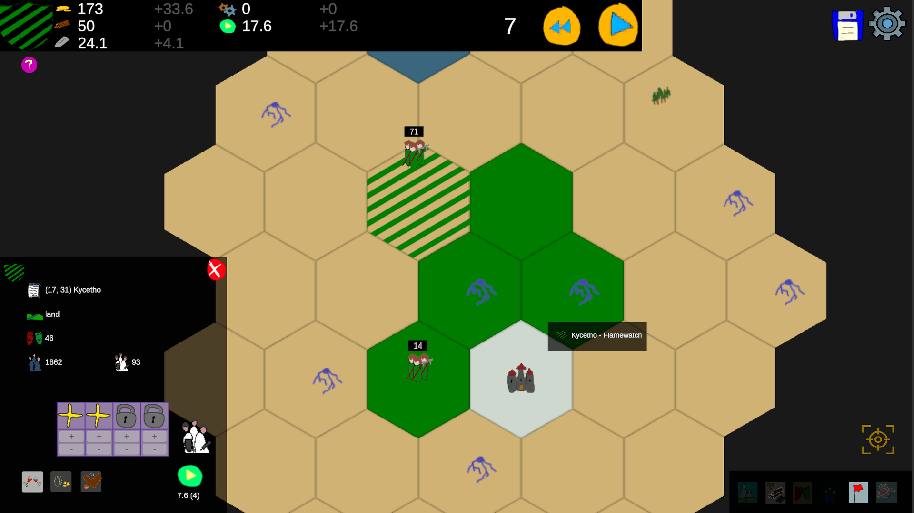 |

| Main Menu | New Game Scenario Setup |
|:---:|:---:|
| 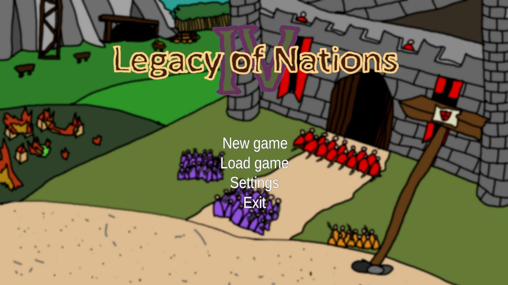 | 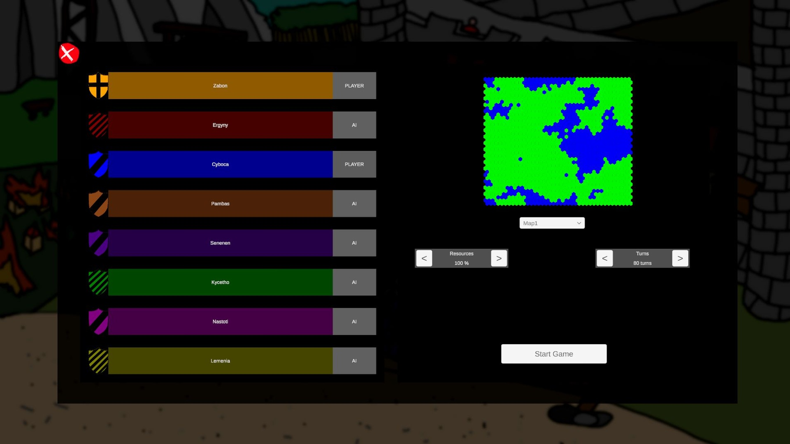 |

| Terrain Biomes Map Mode | Population Density Map Mode |
|:---:|:---:|
| 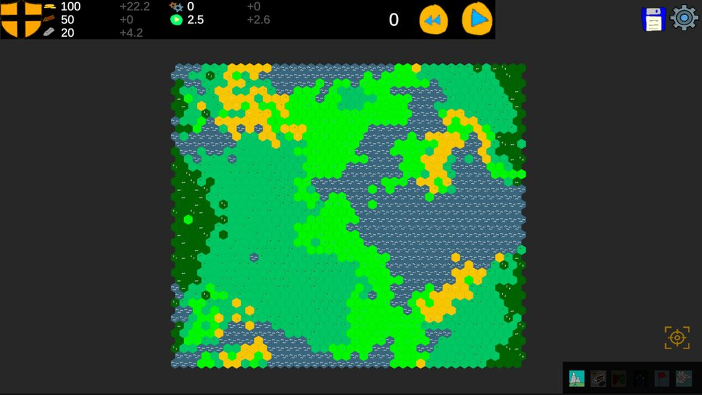 | 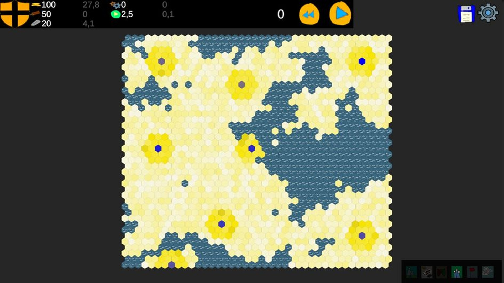 |

| Technology Research Tree | Diplomatic Actions & Treaties |
|:---:|:---:|
| 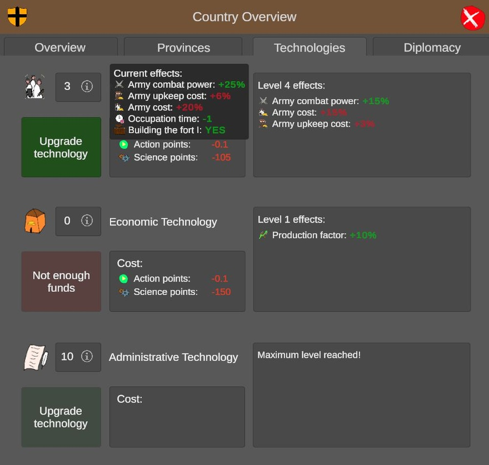 | 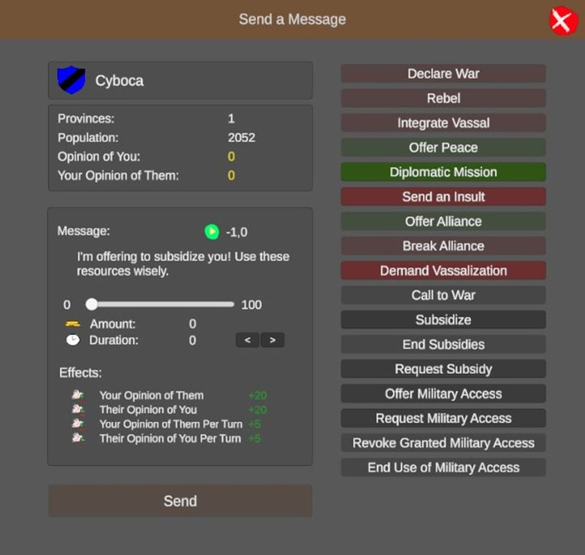 |

| International Relations & Opinions | Controlled Provinces Overview |
|:---:|:---:|
| 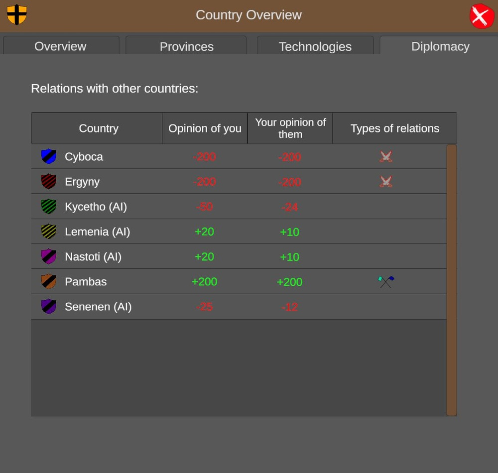 | 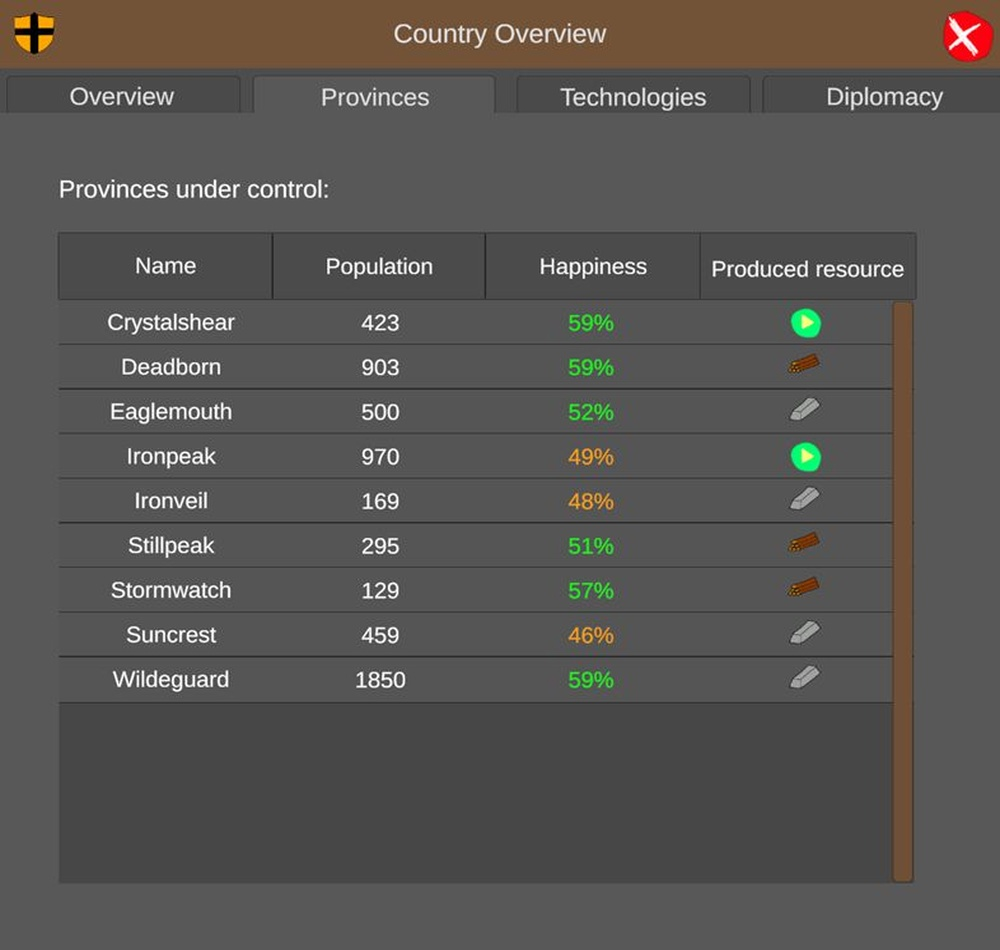 |

| Fog of War & Territorial Occupation | Army Movement & Unit Split Dialog |
|:---:|:---:|
| 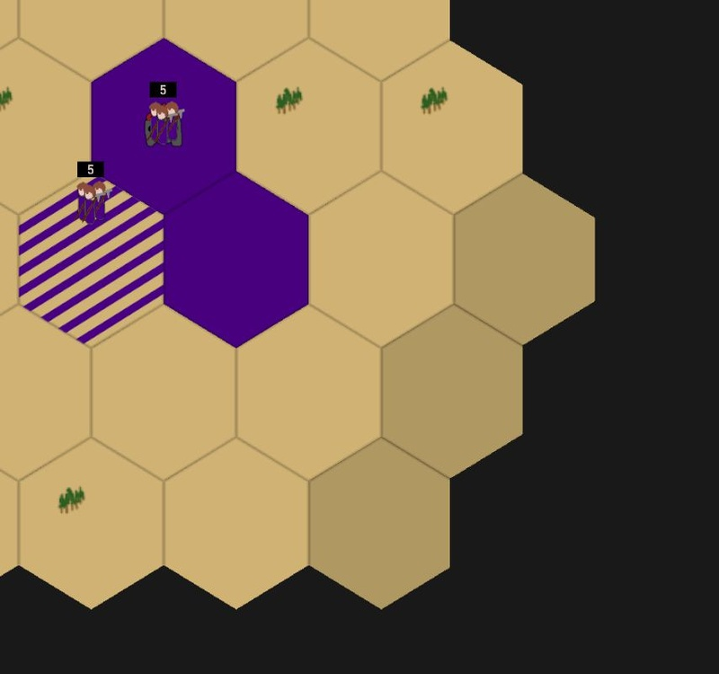 | 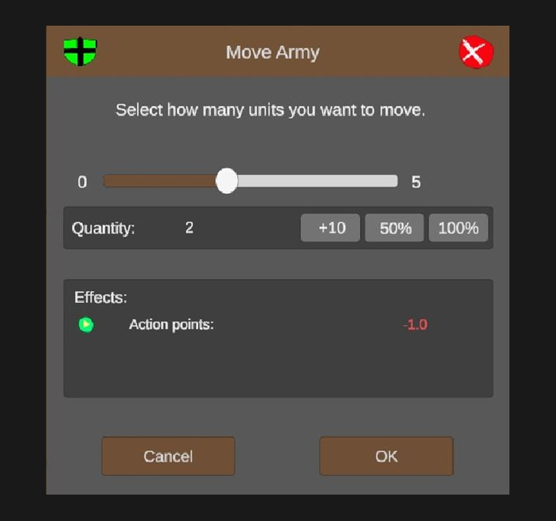 |

---

## Features

- **Hexagonal Grid World & Multi-Layer Tilemaps:** Modular hexagonal world map where each province stores individual properties (population, happiness, resources, terrain type, structures) rendered using layered tilemaps (base terrain, political borders, occupation stripes, natural features, capitals, and dynamic fog of war).
- **6 Interactive Map Filters:** Seamlessly toggle between multiple data visualizations: Political (national borders and occupation stripes), Terrain (tundra, lowlands, forest, desert, water), Resources (Gold, Wood, Iron, Action Points), Happiness (gradient heat-map from red to green), Population (dynamic relative color scaling), and Diplomatic Relations.
- **Economy & Dynamic Taxation:** Province-level resource generation (Gold, Wood, Iron, Action Points, Science Points) balanced against national tax policies (Low, Medium, High, Wartime, Investment) affecting treasury growth and public unrest.
- **Multi-Branch Technology Tree:** 3 distinct scientific trees (Economic, Military, Administrative) across 10 progressive tiers, unlocking advanced buildings (Mines, Forts, Schools), naval transport, festival hosting, tax breaks, and combat bonuses.
- **Bilateral Diplomacy & Reputation:** Asymmetric bilateral relations and dynamic opinion scoring (-200 to +200) governing alliances, formal war declarations, truces, vassalization, tribute subsidies, military access agreements, insults, and praising missions.
- **Turn-Based Actions with Preview & Undo:** Interactive command queue (recruiting armies, moving regiments, constructing or downgrading buildings, organizing festivals, suppressing revolts) featuring live resource deduction previews and full undo capability prior to turn confirmation.
- **Strategic Artificial Intelligence (AI):** Fully autonomous computer opponents operating on a strategic personality system (`Humor`: Leading, Offensive, Defensive, Rebellious, Subservient, Normal) governing economy, military conquest, hexagonal pathfinding, and diplomatic treaties.
- **Fog of War & Reconnaissance:** Two-tier fog of war system differentiating between explored historical memory (`SeenTiles`) and active line-of-sight vision (`RevealedTiles`) tied to army positions and controlled territory.
- **Custom Scenarios & Fast Binary Saves:** Map scenarios defined in structured, easily modifiable JSON files, accompanied by compact binary game persistence (`.save`) with automated multi-turn autosaving.

---

## Tech Stack

- **Game Engine:** Unity 2022.3.37f1 LTS (2D Tilemaps, UGUI, AudioMixer, Sprite Masks & Custom Shaders)
- **Programming Language:** C# 9.0 (.NET Framework / Mono runtime)
- **Data Formats:** JSON (Newtonsoft.Json for scenario definitions), Binary Serialization (`BinaryFormatter` / Stream for fast `.save` files)
- **Testing Framework:** Unity Test Framework (NUnit), Unity EditMode & PlayMode tests
- **UI & Graphics:** Figma (UI/UX design & prototyping), Paint.NET (custom pixel art, icons, coat of arms, sprites), Mosframe Dynamic ScrollView
- **Target Platforms:** Windows 10/11, Linux (tested on Kubuntu / Ubuntu), macOS

---

## Controls & Keybindings

| Key / Shortcut | Action | Description |
|---|---|---|
| `Space` | End Turn | Finalize and execute queued turn actions |
| `Space + Shift` | Quick End Turn | End turn immediately without confirmation prompt |
| `Backspace` | Undo Action | Revert the last pending action in the current turn |
| `Backspace + Shift` | Undo All Actions | Revert all queued actions and refund spent resources |
| `Q` / `W` / `E` / `R` | Country Panels | Toggle Overview (`Q`), Provinces (`W`), Technologies (`E`), Diplomacy (`R`) |
| `F` | Quick Recruit | Open army recruitment modal on selected province |
| `Ctrl + S` | Quick Save | Save current game state to `quicksave.save` |
| `I` / `O` / `P` | Map Modes | Switch map filter to Terrain (`I`), Resource (`O`), Happiness (`P`) |
| `J` / `K` / `L` | Map Modes | Switch map filter to Population (`J`), Political (`K`), Diplomatic (`L`) |
| `RMB (Drag)` / `Arrows` | Camera Pan | Move the camera across the hexagonal battlefield |
| `Scroll Wheel` | Camera Zoom | Smooth orthographic camera zoom with adaptive speed |
| `Esc` | Close / Cancel | Close open interface window, dismiss dialog, or deselect unit |

---

## Quick Start

### Requirements
- [Unity Hub](https://unity.com/download)
- **Unity Editor 2022.3.37f1** (LTS) with **Linux / Windows Build Support (Mono)**

### 1. Clone the repository
```bash
git clone https://github.com/Abacysta/UnityInzynierka.git
cd UnityInzynierka
```

### 2. Open project in Unity Hub
1. Launch **Unity Hub**.
2. Click **Add** -> **Add project from disk**.
3. Select the repository root folder (`UnityInzynierka`).
4. Select Unity Editor version **`2022.3.37f1`**.

### 3. Play in Unity Editor
1. In the `Project` tab, open `Assets/scenes/`.
2. Double-click **`main_menu.unity`**.
3. Press the **Play (▶)** button in the top toolbar to start the game.

### 4. Build Standalone Game (Windows / Linux)
1. In the top menu, go to **File** -> **Build Settings...**.
2. Confirm the scenes included in the build:
   - `0: Assets/scenes/main_menu.unity`
   - `1: Assets/scenes/local_play.unity`
   - `2: Assets/scenes/game_map.unity`
3. Set platform to **PC, Mac & Linux Standalone** (Target OS: *Linux* or *Windows*, Architecture: *x86_64*).
4. Click **Build** and choose an output folder (e.g. `Builds/`). *(Note: `PostBuildCopy.cs` automatically copies scenario maps from `Assets/Resources/Maps` to the build directory).*

---

## Running Tests

### Unit & Integration Tests (Unity Test Framework)
The project includes automated Unit Tests and Integration Tests located in `Assets/tests/edit_mode_tests/`.

To run tests in Unity:
1. Open the project in **Unity Editor**.
2. Navigate to **Window** -> **General** -> **Test Runner**.
3. Select the **EditMode** tab.
4. Click **Run All** to execute all tests.

### Test Suite Overview
| Test Suite | File | Focus Area |
|---|---|---|
| `HappinessTests` | [`HappinessTests.cs`](Assets/tests/edit_mode_tests/HappinessTests.cs) | Enforces province happiness boundaries [0, 100] |
| `OpinionTests` | [`OpinionTests.cs`](Assets/tests/edit_mode_tests/OpinionTests.cs) | Validates bilateral country opinion limits [-200, +200] |
| `BuildingTests` | [`BuildingTests.cs`](Assets/tests/edit_mode_tests/BuildingTests.cs) | Checks building upgrade tiers, population gates, and resource prerequisites |
| `ArmyUnitCounterTests` | [`ArmyUnitCounterTests.cs`](Assets/tests/edit_mode_tests/ArmyUnitCounterTests.cs) | Integration test verifying army counter UI updates and event triggers |
| `StartWarActionTests` | [`StartWarActionTests.cs`](Assets/tests/edit_mode_tests/StartWarActionTests.cs) | Integration test verifying diplomatic state transitions upon war declaration |
| `TaxButtonsTests` | [`TaxButtonsTests.cs`](Assets/tests/edit_mode_tests/TaxButtonsTests.cs) | Integration test ensuring UI tax toggles correctly update country treasury and happiness |

<p align="center">
  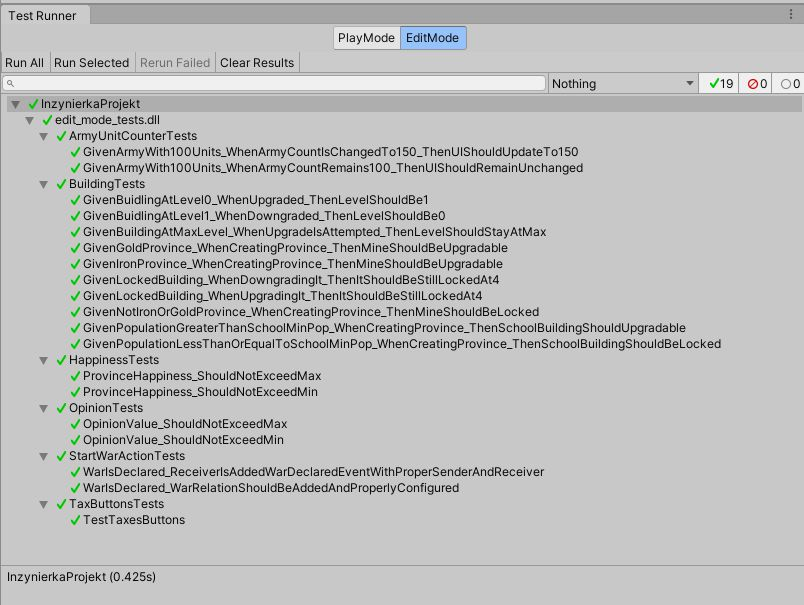
</p>

---

## Architecture & Core Classes

The game logic follows an object-oriented and data-driven architecture separating data models (`ScriptableObject`), managers, and command pattern actions:

| Class / Script | Responsibility | Key Mechanics & Patterns |
|---|---|---|
| `Map` | Central game state container (`ScriptableObject`) | Stores all provinces, countries, armies, active relations, and turn counters |
| `game_manager` | Main simulation loop & turn calculation | Orchestrates pre-turn resets, round-robin action execution, AI turns, and win conditions |
| `TurnAction` | Command pattern base for player actions | Supports `Preview`, `Execute`, and `Revert` operations with resource refunding |
| `Country` | Sovereign state model | Manages treasury, tech tree progression, modifiers, vassal relations, and fog of war |
| `Province` | Hex cell data representation | Manages population growth, happiness, buildings, resource extraction, and occupation |
| `AI_manager` | Autonomous opponent logic | Behavioral state machine evaluated via strategic `Humor` profiles and goal weights |
| `diplomatic_relations_manager` | Foreign relations controller | Manages alliances, wars, truces, military access, subsidies, and vassalage |
| `dialog_box_manager` | Dynamic popup dialog system | Implements the **Builder Pattern** (`DialogBoxBuilder`) for customizable prompts |
| `camera_controller` | Viewport & navigation controller | Smooth panning, clamping, orthographic zoom scaling, and province focus |
| `HexUtils` | Hexagonal geometry math | 3D cube coordinates (`q + r + s = 0`) for neighbor lookups, distance, and A* pathfinding |

### System Architecture & Class Model
<p align="center">
  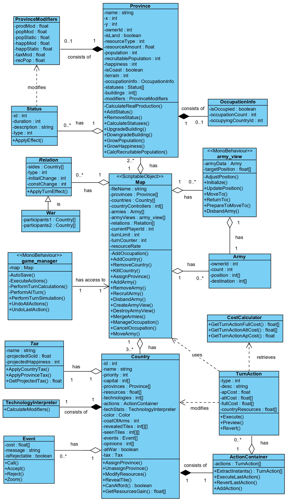
</p>

### Turn Execution & Resolution Flow
<p align="center">
  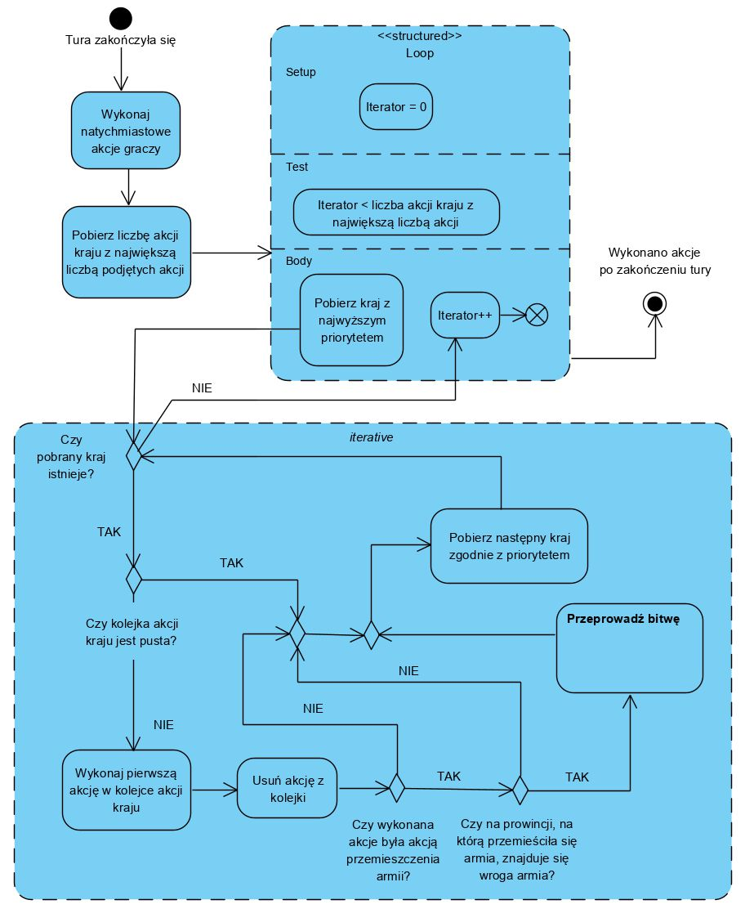
</p>

### Complete UML Activity Diagrams Catalog (`docs/diagrams/`)
The engineering thesis models core game mechanics and turn progression loops with formal UML activity diagrams:

| Process / Mechanic | Diagram File | Description |
|---|---|---|
| **System Architecture** | [`uml-class-diagram.jpg`](docs/diagrams/uml-class-diagram.jpg) | High-level class relationships, managers, and data structures |
| **New Game Setup** | [`uml-activity-new-game.jpg`](docs/diagrams/uml-activity-new-game.jpg) | Main menu selection, map generator, country picking, and state setup |
| **Province Interaction** | [`uml-activity-province-action.jpg`](docs/diagrams/uml-activity-province-action.jpg) | Construction, recruitment, and infrastructure investments |
| **Diplomatic Actions** | [`uml-activity-diplomatic-action.jpg`](docs/diagrams/uml-activity-diplomatic-action.jpg) | Treaty proposals, alliances, declarations of war, and financial subsidies |
| **Army Movement** | [`uml-activity-army-movement.jpg`](docs/diagrams/uml-activity-army-movement.jpg) | Target hex validation, movement confirmation, and repositioning |
| **Turn Action Queue** | [`uml-activity-turn-action-preview.jpg`](docs/diagrams/uml-activity-turn-action-preview.jpg) | Command queuing, visual preview, cost deduction, and rollback |
| **Rebellion Outbreak** | [`uml-activity-rebellion-outbreak.jpg`](docs/diagrams/uml-activity-rebellion-outbreak.jpg) | Province happiness check, unrest escalation, and rebel army spawn |
| **Turn Execution Loop** | [`uml-activity-turn-execution.jpg`](docs/diagrams/uml-activity-turn-execution.jpg) | End-of-turn round carousel resolving human and AI actions |
| **Battle Resolution** | [`uml-activity-battle-resolution.jpg`](docs/diagrams/uml-activity-battle-resolution.jpg) | Military strength calculation, battle outcome, and casualty allocation |
| **Occupation Management** | [`uml-activity-occupation-management.jpg`](docs/diagrams/uml-activity-occupation-management.jpg) | Hex occupation status change, garrisoning, and sovereignty shift |
| **Province Calculations** | [`uml-activity-province-calculations.jpg`](docs/diagrams/uml-activity-province-calculations.jpg) | Turn-end population growth, happiness drift, and modifier updates |
| **Resource Calculations** | [`uml-activity-resource-calculations.jpg`](docs/diagrams/uml-activity-resource-calculations.jpg) | National treasury calculation, tax collection, and military upkeep |

### UI / UX Design Specifications (`docs/design/`)
Pre-implementation UI wireframes and vector mockups designed in Figma:

| UI View / Component | Mockup File | Description |
|---|---|---|
| **Country Production** | [`mockup-country-production.jpg`](docs/design/mockup-country-production.jpg) | Tax rate sliders, economic balances, resource growth breakdown |
| **Country Provinces** | [`mockup-country-provinces.jpg`](docs/design/mockup-country-provinces.jpg) | Controlled territories list, happiness indicators, resource icons |
| **Technology Tree** | [`mockup-country-technology.jpg`](docs/design/mockup-country-technology.jpg) | Military, economic, and administrative upgrade paths with costs |
| **Diplomacy Overview** | [`mockup-country-diplomacy.jpg`](docs/design/mockup-country-diplomacy.jpg) | Bilateral opinion matrix, status indicators, and foreign treaty list |
| **Diplomatic Actions** | [`mockup-diplomatic-actions.jpg`](docs/design/mockup-diplomatic-actions.jpg) | Action modal: send insult, offer alliance, demand vassalage, subsidies |
| **Action Dialog Box** | [`mockup-action-dialog-box.jpg`](docs/design/mockup-action-dialog-box.jpg) | Dynamic confirmation modal with quantity slider and AP cost preview |
| **Province Interface** | [`mockup-province-interface.jpg`](docs/design/mockup-province-interface.jpg) | Hex details panel: terrain type, population, local happiness |
| **Main Gameplay HUD** | [`mockup-main-hud.jpg`](docs/design/mockup-main-hud.jpg) | Top bar counters for gold, wood, iron, science, and action points |

---

## Authors

- **Michał Muzyka** — [GitHub](https://github.com/musmike)
- **Mateusz Niedźwiedź** — [GitHub](https://github.com/JonaszGoldbaumm)
- **Filip Nocoń** — [GitHub](https://github.com/Abacysta)

*Academic Thesis Project (Praca dyplomowa inżynierska)*  
*Supervisor:* **dr inż. Jakub Smołka**  
*Department:* Faculty of Electrical Engineering and Computer Science, **Lublin University of Technology** (*Politechnika Lubelska*), 2025.
